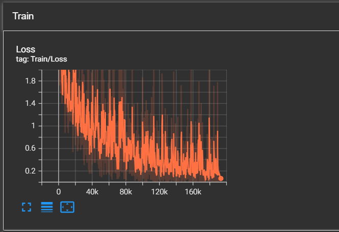
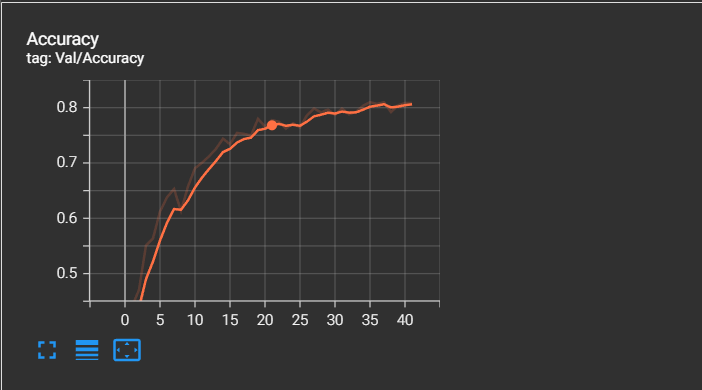

<div align="center">

# 🐾 Animal-10 Classification with Custom PyTorch CNN

An end-to-end Deep Learning project for classifying 10 animal species from scratch using a custom-designed Convolutional Neural Network (CNN) built with **PyTorch**, accelerated by **NVIDIA CUDA**, and monitored in real time via **TensorBoard**.

[](https://www.python.org/)
[-EE4C2C?style=for-the-badge&logo=pytorch&logoColor=white)](https://pytorch.org/)
[](https://www.tensorflow.org/tensorboard)
[](https://opensource.org/licenses/MIT)

</div>

---

## 📌 Table of Contents
- [Overview](#-overview)
- [Model Architecture](#-model-architecture)
- [Training & Evaluation Results](#-training--evaluation-results)
- [Project Structure](#-project-structure)
- [Getting Started](#-getting-started)
  - [Prerequisites](#prerequisites)
  - [Installation](#installation)
  - [Dataset Preparation](#dataset-preparation)
- [Training](#-training)
- [Inference](#-inference)
- [Tech Stack](#-tech-stack)

---

## 📖 Overview

This repository provides a complete pipeline for 10-class animal image classification:
- **Classes (10 Categories)**: `butterfly`, `cat`, `chicken`, `cow`, `dog`, `elephant`, `horse`, `sheep`, `spider`, `squirrel`.
- **Custom Dataset Loader**: Robust loading with real-time transforms and batch pre-processing.
- **Optimized for Hardware Constraints**: Tuned data pipeline with GPU memory management (`CUDA empty_cache`, memory leak prevention).

---

## 🧠 Model Architecture

The core model, **`SimpleCNN`**, is designed with a deep 5-stage feature extraction backbone followed by a regularized multi-layer perceptron (MLP) classification head:

```text
Input (3 x 224 x 224)
   │
   ├── [Block 1] Conv2d (3 -> 8, 3x3)   -> BN -> LeakyReLU -> Conv2d (8 -> 8, 3x3)   -> BN -> LeakyReLU -> MaxPool2d (2x2) -> (8, 112, 112)
   ├── [Block 2] Conv2d (8 -> 16, 3x3)  -> BN -> LeakyReLU -> Conv2d (16 -> 16, 3x3) -> BN -> LeakyReLU -> MaxPool2d (2x2) -> (16, 56, 56)
   ├── [Block 3] Conv2d (16 -> 32, 3x3) -> BN -> LeakyReLU -> Conv2d (32 -> 32, 3x3) -> BN -> LeakyReLU -> MaxPool2d (2x2) -> (32, 28, 28)
   ├── [Block 4] Conv2d (32 -> 64, 3x3) -> BN -> LeakyReLU -> Conv2d (64 -> 64, 3x3) -> BN -> LeakyReLU -> MaxPool2d (2x2) -> (64, 14, 14)
   └── [Block 5] Conv2d (64 -> 128, 3x3)-> BN -> LeakyReLU -> Conv2d (128->128, 3x3)-> BN -> LeakyReLU -> MaxPool2d (2x2) -> (128, 7, 7)
   │
   ▼
Flatten (128 * 7 * 7 = 6,272 features)
   │
   ├── Dropout (p = 0.5) -> Linear (6272 -> 512) -> LeakyReLU
   ├── Dropout (p = 0.5) -> Linear (512 -> 1024) -> LeakyReLU
   └── Dropout (p = 0.5) -> Linear (1024 -> 10)  -> Class Logits
```

### Key Design Highlights:
1. **Double Convolution Blocks**: Each stage extracts deep localized spatial patterns prior to pooling.
2. **Batch Normalization & LeakyReLU**: Ensures smooth gradient flow and prevents the "Dying ReLU" problem.
3. **Dropout Regularization**: Heavy 50% dropout across all FC layers prevents overfitting on limited datasets.

---

## 📈 Training & Evaluation Results

During training with SGD Optimizer (`lr=0.001`, `momentum=0.9`), the model demonstrates smooth convergence and steady metric improvements:

| Metric | Peak Performance | Epoch |
| :--- | :---: | :---: |
| **Validation Accuracy** | **~81.2%** | ~40 |
| **Training Loss** | Converged to **~0.15 - 0.20** | 40+ |

<div align="center">
  <table>
    <tr>
      <td align="center"><b>Training Loss (Smoothed)</b></td>
      <td align="center"><b>Validation Accuracy</b></td>
    </tr>
    <tr>
      <td></td>
      <td></td>
    </tr>
  </table>
</div>

---

## 📂 Project Structure

```text
├── assets/
│   ├── loss.png                   # Training loss curve
│   └── accuracy.png               # Validation accuracy curve
├── dl_ex5.py                      # Custom PyTorch Dataset definition
├── model2.py                      # SimpleCNN & SimpleNeuralNetwork models
├── trainneuralnetwork_2.py        # Complete training loop with checkpointing & TensorBoard
├── predict.py                     # Single image inference script
├── test_cat.jpg                   # Sample test image
├── requirements.txt               # Python package dependencies
├── .gitignore                     # Git ignore rules (prevents tracking venv & cache)
└── README.md                      # Project documentation
```

---

## 🚀 Getting Started

### Prerequisites
- Python 3.10 or higher
- NVIDIA GPU with CUDA support (Recommended for fast training)

### Installation

1. **Clone the repository:**
   ```bash
   git clone https://github.com/<your-username>/animal-classification-pytorch.git
   cd animal-classification-pytorch
   ```

2. **Create and activate a virtual environment:**
   - **Windows:**
     ```powershell
     python -m venv venv
     .\venv\Scripts\Activate.ps1
     ```
   - **Linux / macOS:**
     ```bash
     python3 -m venv venv
     source venv/bin/activate
     ```

3. **Install dependencies:**
   For CUDA 12.4 support (NVIDIA GPUs):
   ```bash
   pip install torch torchvision --index-url https://download.pytorch.org/whl/cu124
   pip install -r requirements.txt
   ```

---

## 🗂 Dataset Preparation

Organize your dataset following standard classification folder convention:

```text
animals/
├── Train/
│   ├── butterfly/
│   ├── cat/
│   ├── ...
│   └── squirrel/
└── Test/
    ├── butterfly/
    ├── cat/
    ├── ...
    └── squirrel/
```

---

## 🏋️ Training

To train the model using CLI arguments:

```bash
python trainneuralnetwork_2.py --root "D:/University/AI/DeepLearning/animals" --epochs 50 --batch-size 8 --image-size 224
```

### CLI Parameters:
| Argument | Flag | Default | Description |
| :--- | :---: | :---: | :--- |
| `--root` | `-r` | `./data` | Path to root dataset directory containing `Train` and `Test` |
| `--epochs` | `-e` | `100` | Number of training epochs |
| `--batch-size` | `-b` | `4` | Batch size (Adjust to 4/8/16 based on VRAM capacity) |
| `--image-size` | `-i` | `224` | Input image resolution (width & height) |
| `--logging` | `-l` | `tensorboard` | Output directory for TensorBoard logs |

### Real-Time Monitoring
Launch TensorBoard to track loss and accuracy curves in real-time:
```bash
tensorboard --logdir tensorboard
```
Open [http://localhost:6006](http://localhost:6006) in your browser.

---

## 🔮 Inference

Test the model on an arbitrary image with [`predict.py`](file:///d:/University/AI/DeepLearning/Animal detection/predict.py):

```bash
python predict.py
```

Or invoke in your own script:

```python
from predict import predict_image

# Predict a single image
predicted_class = predict_image("path/to/sample.jpg")
print(f"Result: {predicted_class}")
```

---

## 🛠 Tech Stack

- **Framework**: [PyTorch](https://pytorch.org/) & [Torchvision](https://pytorch.org/vision/)
- **Acceleration**: NVIDIA CUDA
- **Logging & Tracking**: TensorBoard, Tqdm
- **Evaluation**: Scikit-Learn (Classification Report)
- **Image Processing**: PIL (Pillow), OpenCV

---

## 📄 License
This project is licensed under the MIT License - see the LICENSE file for details.
